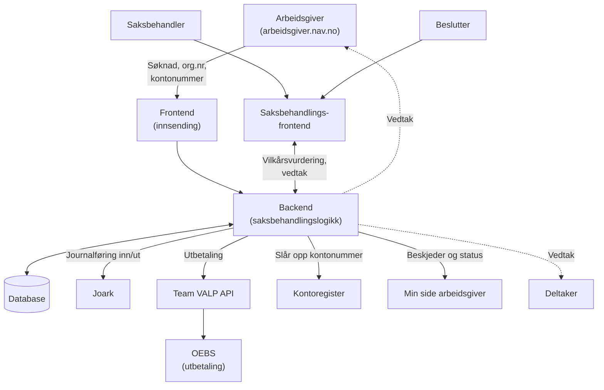
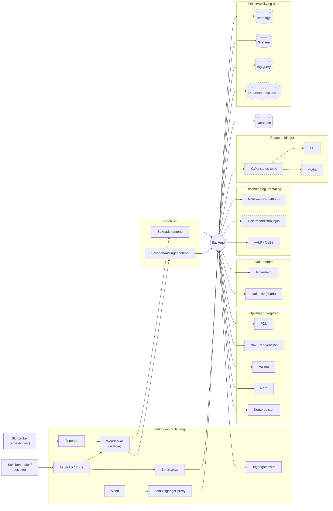

# Ekspertbistand

Dette repoet inneholder løsningen for tiltaket **ekspertbistand** i Nav, utviklet
av Team Fager. Løsningen erstatter den tidligere behandlingen i Altinn 2 og Arena.

Dokumentet forklarer hva ekspertbistand er og hva løsningen skal løse, slik at både
mennesker og AI-agenter raskt får domenekontekst før de leser koden. Teknisk
detalj ligger i `frontend/README.md`, `frontend/saksbehandling/README.md`,
`backend/README.md` og `specifications/`.

For spørsmål, kontakt Team Fager på Slack:
[#team-fager](https://nav-it.slack.com/archives/C01V9FFEHEK).

## Hva er ekspertbistand?

Ekspertbistand er en tilskuddsordning for arbeidsgivere som har en ansatt med
langvarig eller gjentakende sykefravær. Arbeidsgiver kan hente inn en ekstern
ekspert som hjelper arbeidsgiver og den ansatte med å finne løsninger på det som
er vanskelig på arbeidsplassen. Nav gir tilskudd som dekker utgiftene til
eksperten.

Eksperten er en nøytral tredjepart med relevant kompetanse på arbeidsplass- og
sykefraværsproblematikk. Ordningen er beskrevet på
[nav.no/ekspertbistand](https://www.nav.no/ekspertbistand).

## Hvilket problem løser vi?

- **Arbeidsgiver** trenger hjelp når egne tiltak ikke er nok til å håndtere et
  langvarig eller gjentakende sykefravær, og skal slippe å bære kostnaden for
  ekstern ekspertise alene.
- **Arbeidstakeren (deltakeren)** trenger tiltak som gjør det mulig å stå i eller
  komme tilbake til arbeid.
- **Nav** vil redusere sykefravær og legge til rette for at flere blir i jobb, og
  må kunne behandle søknader og refusjonskrav effektivt og etterrettelig.

Behandlingen skjer i dag i Arena. Denne løsningen overtar saksbehandlingen når
Arena fases ut, og arbeidsgiver sender søknad direkte i stedet for via Altinn 2.

## Hva gjør løsningen?

Systemets formål er å legge til rette for saksbehandling av søknader og
refusjonskrav for tilskudd til ekspertbistand.

1. **Søknad.** Arbeidsgiver logger inn og sender søknad om tilskudd i
   frontend-applikasjonen (arbeidsgiver.nav.no).
2. **Fordeling.** Saker fordeles basert på virksomhetens organisasjonsnummer.
3. **Vilkårsvurdering.** En saksbehandler vurderer om vilkårene for tilskudd er
   oppfylt.
4. **Vedtak (to-trinns kontroll).** Saksbehandler foreslår utfall, og en beslutter
   godkjenner. Vedtak gis til arbeidsgiver og deltaker.
5. **Gjennomføring.** Eksperten bistår, og arbeidsgiver leverer sluttrapport.
6. **Refusjon.** Arbeidsgiver sender refusjonskrav. Ved avslag på refusjonskravet
   gis vedtaket til arbeidsgiver.
7. **Utbetaling.** Tilskuddet utbetales til kontonummeret arbeidsgiver har oppgitt
   i kontoregisteret.

Inn- og utgående dokumenter journalføres i Joark. Utbetaling skjer gjennom
integrasjon mot OEBS (utbetalingsløsningen) via Team VALPs API-er.

## Aktører og begreper

| Begrep | Betydning |
|--------|-----------|
| **Arbeidsgiver** | Virksomheten som søker om tilskudd og mottar refusjon. |
| **Deltaker / arbeidstaker** | Den ansatte som får bistand fra eksperten. |
| **Ekspert** | Ekstern fagperson som bistår arbeidsgiver og deltaker. |
| **Saksbehandler** | Utreder søknaden og vurderer vilkårene. |
| **Beslutter** | Godkjenner vedtaket i to-trinns kontroll. |
| **Søknad** | Det arbeidsgiver sender inn. |
| **Sak** | Navs behandling av en søknad. |
| **Vilkårsvurdering** | Vurderingen av om vilkårene for tilskudd er oppfylt. |
| **Vedtak** | Avgjørelsen om innvilgelse eller avslag. |
| **Refusjon** | Tilbakebetaling til arbeidsgiver av utgiftene til eksperten. |
| **Sluttrapport** | Arbeidsgivers rapport etter at bistanden er gjennomført. |

## Behandlingens livsløp

Diagrammet viser hvor opplysningene innhentes fra, hvordan de flyter under
behandlingen, og hvor de sendes videre i Nav eller til eksterne.

Opplysninger innhentes fra arbeidsgiver ved innsending og fra interne Nav-registre
under behandlingen. De flyter fra frontend til backend, lagres i databasen og
brukes av saksbehandlere. Videre sendes de til Joark (journalføring), til OEBS via
Team VALP (utbetaling) og til Min side arbeidsgiver (beskjeder og
statusoppdateringer). Kontonummer slås opp i kontoregisteret.

## Systemlandskap

Diagrammet over viser domenet og behandlingens livsløp. Diagrammet under viser det
tekniske systemlandskapet — alle systemene løsningen integrerer mot når den er
ferdig utviklet. Systemer som ennå ikke er bygget, er markert som *planlagt*
(stiplet).

Systemene grupperes i innlogging og tilgang (ID-porten og AzureAD/Entra via
Wonderwall, roller fra Entra-proxy, virksomhetstilganger fra Altinn tilganger-proxy
og persontilgang via Tilgangsmaskin), oppslagsregistre (PDL, Ereg, Aa-reg, Norg,
Kontoregister), dokumentproduksjon og journalføring (Gotenberg, Dokarkiv), utsending
og utbetaling (Notifikasjonsplattform, Dokumentdistribusjon, VALP/OeBS),
statusmeldinger på Kafka til SF og Modia, samt observability og datadeling (Team
logs, Grafana, BigQuery, Datamarkedsplassen). Integrasjoner som ennå ikke er bygget
(Dokumentdistribusjon, VALP/OeBS, Kafka status-topic med SF og Modia, BigQuery og
Datamarkedsplassen) er markert som planlagt.

## Applikasjonene

Den nye løsningen tar imot søknader direkte, uten å gå via Altinn 2, og har egen
saksbehandling.

### Frontend for arbeidsgiver

En React-app (Vite, TypeScript) med Express-BFF i `frontend/client` og
`frontend/server`. Arbeidsgiver logger inn med ID-porten, sender søknad og ser
innsendte søknader, vedtak, sluttrapport og refusjon. Se
[frontend/README.md](/frontend/README.md).

### Frontend for saksbehandling

En React-app (Vite, TypeScript, Aksel) med Express-BFF i `frontend/saksbehandling`
og `frontend/saksbehandling-server`. Saksbehandler og beslutter logger inn med
Entra ID, får saker tildelt, vurderer vilkår og fatter vedtak med to-trinns
kontroll. Appen kjører foreløpig bare i dev. Se
[frontend/saksbehandling/README.md](/frontend/saksbehandling/README.md).

### Backend

En Ktor-applikasjon i Kotlin med all logikk for behandling av søknader, saker og
integrasjoner (Joark, VALP/OEBS, Min side arbeidsgiver). Begge frontendene bruker
samme backend. Se [backend/README.md](/backend/README.md).

## Videre lesing

- [frontend/README.md](/frontend/README.md): frontend for arbeidsgiver.
- [frontend/saksbehandling/README.md](/frontend/saksbehandling/README.md):
  frontend for saksbehandling.
- [backend/README.md](/backend/README.md): backend-applikasjonen.
- [specifications/instruks_asynkron_prosessering.md](/specifications/instruks_asynkron_prosessering.md):
  hvordan søknader prosesseres asynkront gjennom en kø.
- [specifications/](/specifications): detaljerte spesifikasjoner for
  datamodell, ruter og integrasjoner.

## Bakgrunn: hva som erstattes

Tidligere sendte arbeidsgiver søknad om ekspertbistand via Altinn 2, hvor den ble
rutet videre til saksbehandler. Ved innsending ble det opprettet en midlertidig
journalpost og sendt en Kafka-melding som ble lyttet på av
[Dokumentfordeling](https://github.com/navikt/dokumentfordeling), som rutet
journalposten videre til riktig saksbehandler. Dette mottaket er
[beskrevet på Confluence](https://confluence.adeo.no/spaces/TAD/pages/90553562/Verdikjeder),
og rutingen er dokumentert i
[Dokumentfordeling – funksjonell beskrivelse](https://confluence.adeo.no/spaces/AR/pages/294497858/Dokumentfordeling+-+tiltak+-+Funksjonell+bekrivelse#DokumentfordelingtiltakFunksjonellbekrivelse-Ruting).

Saksbehandler behandlet deretter saken i Arena: opprettet tiltaksgjennomføring,
fattet vedtak og sendte tilskuddsbrev. Søknaden sendes nå i denne løsningen, men
saksbehandlingen i prod skjer fortsatt i Arena.

### Ny saksbehandling

Saksbehandlingsfrontenden erstatter Arena for ekspertbistand. Saksbehandler får
saken tildelt, vurderer vilkårene og foreslår vedtak, og en beslutter godkjenner.
Vedtaksbrevet lages i løsningen, journalføres i Joark og vises for arbeidsgiver
på arbeidsgiver.nav.no. Refusjon og utbetaling går via VALP/OEBS i stedet for
Arena.

Hver sak har en kilde som sier hvor den behandles:

- `ARENA`: søknaden ble sendt før ny saksbehandling ble tatt i bruk. Saken
  behandles ferdig i Arena og vises i saksbehandlingsfrontenden uten at den kan
  tildeles.
- `EKSPERTBISTAND`: saken opprettes og behandles i den nye løsningen.

### Utfasing av Arena

Arena fases ut for ekspertbistand i to steg. Når ny saksbehandling er i drift i
prod, får nye søknader kilde `EKSPERTBISTAND`, mens saker som allerede ligger i
Arena, behandles ferdig der. Når den siste Arena-saken er avsluttet, trengs ikke
Arena lenger for ekspertbistand. Datavarehuset får i dag tiltaksstatistikk fra
Arena. For saker med kilde `EKSPERTBISTAND` lager denne løsningen statistikken
selv, se [saksbehandlingsstatistikk.md](/specifications/saksbehandlingsstatistikk.md).

## Test i dev, i mock og lokalt

### Dev

Dev bruker ekte integrasjoner mot dev-miljøene til ID-porten, Entra ID, Altinn og
registrene.

| App | Adresse |
|-----|---------|
| Arbeidsgiver | https://arbeidsgiver.intern.dev.nav.no/ekspertbistand |
| Saksbehandling | https://ekspertbistand-saksbehandling.intern.dev.nav.no |

Logg inn som arbeidsgiver i ID-porten (TestID) med testbrukeren `08879198748`.
I saksbehandling logger du inn med en personlig testbruker i trygdeetaten.no,
som du setter opp i IDA. Oppskriften ligger i et
[canvas i #team-fager-intern på Slack](https://nav-it.slack.com/docs/T5LNAMWNA/F0C49V6NRE1).

### Mock

Mock-appene kjører i dev-gcp uten ekte innlogging og integrasjoner. Se
[frontend/README.md](/frontend/README.md#mock-miljøet-i-dev-gcp) for detaljer.

| App | Adresse | Data |
|-----|---------|------|
| Arbeidsgiver | https://arbeidsgiver-dev.ansatt.dev.nav.no/ekspertbistand | MSW i nettleseren, uten backend |
| Arbeidsgiver mot backend-mock | https://ekspertbistand-arbeidsgiver-e2e-mock.ansatt.dev.nav.no/ekspertbistand | `ekspertbistand-backend-mock` |
| Saksbehandling mot backend-mock | https://ekspertbistand-saksbehandling-mock.ansatt.dev.nav.no | `ekspertbistand-backend-mock` |

Appene mot backend-mocken deler data, og dataene nullstilles når backend-mocken
starter på nytt. I saksbehandling velger du testbruker i headeren.

Arbeidsgiverappen med MSW (og `pnpm dev` lokalt) svarer spesielt på disse
fødselsnumrene når du fyller inn deltaker i søknaden:

| Fødselsnummer | Svar | Hva du ser |
|---------------|------|------------|
| `08879198748` | 200 | Fungerer OK |
| `01819010001` | – | «Er du selv deltakeren?» (den innloggede mockbrukeren) |
| `01819030037` | 422 | «Velg virksomheten som deltaker er ansatt i …» med lenke til Altinn |
| `01819030118` | 429 | For mange oppslag |
| `01819030207` | 503 | Oppslaget feilet |

Andre gyldige fødselsnumre gir også 200.

### Lokalt med LocalApplication

`LocalApplication.kt` i `backend/src/test/kotlin/no/nav/ekspertbistand/` kjører
backend på port 8080 med mockede integrasjoner og testdata fra `LokaleSaker.kt`.
Frontendene bygges og serveres av BFF-ene uten MSW, så alle kall går til
`LocalApplication`.

1. Start databasen: `docker-compose -f backend/docker-compose.yml up`
2. Kjør `LocalApplication.kt`.
3. Start frontend fra repo-roten:

| Kommando | Hva starter | Adresse |
|----------|-------------|---------|
| `pnpm serve:e2e` | Frontend for arbeidsgiver | http://localhost:4000 |
| `pnpm serve:saksbehandling:e2e` | Frontend for saksbehandling | http://localhost:4001 |
| `pnpm serve:all:e2e` | Begge | http://localhost:4000 og http://localhost:4001 |

Med `pnpm serve:all:e2e` kan du teste hele flyten: send søknad som arbeidsgiver,
behandle og fatt vedtak i saksbehandling, og send refusjon og sluttrapport som
arbeidsgiver. I saksbehandling bytter du bruker under «Bytt bruker (lokalt)» i
brukermenyen. Se [frontend/README.md](/frontend/README.md#kjøre-frontend-og-backend)
og [frontend/saksbehandling/README.md](/frontend/saksbehandling/README.md) for
testbrukere og hot reload.
