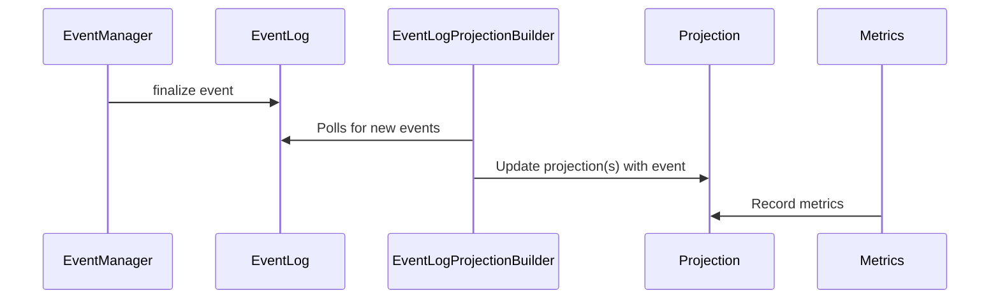

# EventLogProjectionBuilder 

The `EventLogProjectionBuilder` is responsible for constructing and updating projections based on events stored in the `EventLog`. Projections are read-optimized views or models derived from the sequence of events, enabling efficient queries and reporting.

## Sequence Diagram

Below is a Mermaid sequence diagram illustrating the flow between the `EventLog`, `EventLogProjectionBuilder`, and projections:

For details on the EventManager / EventLog, see [events/README](../README.md).

## Flow Description

1. **EventLog**: Stores all domain events in an append-only fashion.
2. **EventLogProjectionBuilder**: Listens to new events in the `EventLog` and applies them to update one or more projections.
3. **Projections**: Materialized views (e.g., `TilskuddsbrevVistProjection`, `SoknadBehandletForsinkelseProjection`, `SakProjection`) that are updated by the builder and used for efficient querying.

## Projeksjoner leser bare `event_log`

En projeksjon leser `event_log` og skriver til sine egne tabeller, som `sak`. Den skriver aldri til `event_log`,
heller ikke når den backfiller eller kjøres på nytt fra posisjon 0. Alt i `event_log` har kommet via
`event_queue` og `finalize`, uten unntak. Se [`event_log` endres aldri](../README.md#event_log-endres-aldri).

Trenger en projeksjon en hendelse som ikke finnes i loggen, må vanlig applikasjonskode publisere den som en
ny event med `publishEventQueue`. Projeksjonen får den da på samme måte som alle andre events.

## SakProjection

`SakProjection` bygger `sak`-tabellen for søknader som behandles i Arena. Se
[`specifications/sak_projection.md`](../../../../../../../../../specifications/sak_projection.md).

| Event | Effekt på `sak` |
|-------|-----------------|
| `SoknadInnsendt` | Oppretter saken (`OPPRETTET`, `kilde_til_behandling = ARENA`), men kun hvis søknaden finnes og ikke allerede har en sak |
| `InnsendtSoknadJournalfoert` | Setter `behandlende_enhet`, mappet tilbake fra Arena- til Norg-enhetsnummer (`BehandlendeEnhetService.arenaTilNorgEnhetNr`) |
| `TiltaksgjennomforingOpprettet` | Setter `arena_sak_id` |
| `SaksbehandlingStartetIArena` | `UNDER_BEHANDLING`, kun fra `OPPRETTET` |
| `TilskuddsbrevMottatt` | `INNVILGET`, med mindre saken allerede er `INNVILGET`/`AVSLATT` |
| `SoknadAvlystIArena` | `AVSLATT`, med mindre saken allerede er `INNVILGET`/`AVSLATT` |
| `SakTildeltSaksbehandler` | Setter `saksbehandler_ident`, `saksbehandler_navn` og `tildeling_event_id`, og `OPPRETTET` → `UNDER_BEHANDLING`. Gjelder alle saker uansett kilde. Hopper over eventen når `tildeling_event_id` er nyere |
| `SakFrigjort` | Nuller `saksbehandler_ident` og `saksbehandler_navn` hvis identen fortsatt har saken. Status endres ikke |

`opprettet` og `sist_endret` settes fra eventens tidspunkt, slik at replay gir riktige tidspunkter.

Tildeling og frigjøring bruker `tildelSak` og `frigjoerSak` i `saksbehandling/Db.kt`, de samme funksjonene som
handlerne `TildelSaksbehandler` og `FrigjoerSak`. Live har handleren allerede brukt eventen, og projeksjonen endrer
ingenting. Projeksjonen publiserer ikke `SakOppdatert`, så saksloggen bygges ikke på nytt ved replay.

For å kjøre hele projeksjonen på nytt, bump versjonen i `name` (for eksempel `Sak-v2` → `Sak-v3`). Den nye
builderen starter på posisjon 0. Eksisterende saker opprettes ikke på nytt, men feltene deres oppdateres.

## SaksbehandlingsstatistikkProjection

Ligger i pakken `statistikk`. Skriver meldinger til felles saksbehandlingsstatistikk (Team Sak) og tiltaksstatistikk
i datavarehuset til BigQuery-tabellen `ekspertbistand_statistikk.saksbehandlingsstatistikk`, én rad per relevant
hendelse. Mottakerne leser viewet `saksbehandlingsstatistikk_delt`, som holder behandlinger med adressebeskyttelse
utenfor. Projeksjonen lagrer ingen tilstand. Den bygger tilstanden fra tidligere eventer med samme aggregatrot i
`event_log`. Bare saker opprettet av `OpprettSak` rapporteres, og projeksjonen kjører derfor bare utenfor prod.
Bump versjonen i `name` for å resende alle meldinger. Mapping og beslutninger står i
[`specifications/saksbehandlingsstatistikk.md`](../../../../../../../../../specifications/saksbehandlingsstatistikk.md)
og [`statistikk/README.md`](../../statistikk/README.md).

## Example

- When a new event is appended to the `EventLog`, the `EventLogProjectionBuilder` processes the event and updates the relevant projections.
- Projections are then used by the application to serve queries without scanning the entire event log.

