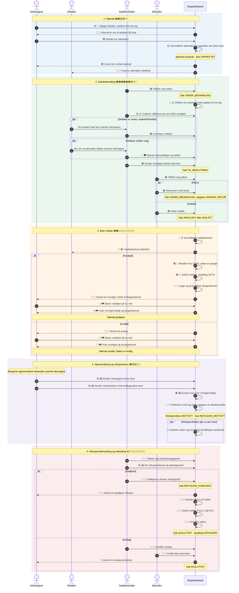
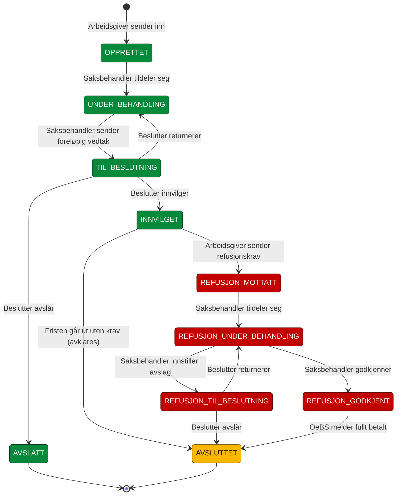

# Aktører og tilstander: fra søknad til utbetalt refusjon

Dette dokumentet viser hva arbeidsgiver, deltaker, saksbehandler og beslutter
gjør med løsningen, fra søknaden sendes inn til refusjonen er utbetalt. Hvert
steg er merket med status, så vi ser hva vi har og hva som mangler.

Gjelder saker i ny saksbehandling (kilde `EKSPERTBISTAND`). Arena-saker
behandles ferdig i Arena og er ikke med. Klage og tilbakekreving er utenfor
løsningen.

Arbeidsgiver ser nye saker på nye sider under en egen rute bak feature toggle
(🛤️). Dagens sider beholdes uendret for Arena-saker.

Andre dokumenter i mappa:

- [Lanseringsplan](lanseringsplan_2027-04-01.md): status, rekkefølge, spor og
  endringslogg fram til 1. april 2027
- [Tidslinje](https://htmlpreview.github.io/?https://github.com/navikt/ekspertbistand/blob/main/planning/lanseringsplan_2027-04-01.html):
  Gantt-diagram over sporene uke for uke

## Interaksjoner

Hvert steg er merket med status:

- 🟢 finnes, i prod eller klart i dev
- 🟡 delvis: bygget, men ikke koblet inn, bare i dev eller mangler noe
- 🔴 mangler

Emojien etter statusen er steget i [lanseringsplanen](lanseringsplan_2027-04-01.md),
for eksempel 🧾 for refusjonsbehandling. Statusene er fra 31.10.2026.

🟢🟢🟢🟢🟢🟢🟢🟢🟢🟢🟢🟡🟡🟡🟡🟡🟡🔴🔴🔴🔴🔴🔴🔴🔴🔴🔴🔴🔴🔴🔴🔴🔴🔴🔴🔴🔴🔴🔴🔴🔴

🟢 11 finnes · 🟡 6 delvis · 🔴 24 mangler, av 41 steg i diagrammet. OeBS er ikke egen deltaker i
diagrammet. Kall til og svar fra OeBS vises som steg i Ekspertbistand.

Deltaker får ikke varsel om refusjonen. Bare arbeidsgiver varsles når
refusjonen er godkjent.

## Tilstander for saken

Grønn finnes i `Saksstatus`. Gul finnes i enumen, men ingenting setter den.
Rød er forslag, og navnene avklares i specen for 🧾.

## Tilstander på tvers

Hver aktør ser sin egen status. Tabellen viser hvordan de henger sammen.

| Fase | Søknad (arbeidsgiver ser) | Sak (saksbehandling) | Refusjonskrav (arbeidsgiver ser) | OeBS |
|------|---------------------------|----------------------|----------------------------------|------|
| Utkast | 🟢 `utkast` | – | – | – |
| Sendt inn | 🟢 `innsendt` | 🟢 `OPPRETTET` | – | – |
| Under behandling | 🟢 `innsendt` | 🟢 `UNDER_BEHANDLING` | – | – |
| Til beslutning | 🟢 `innsendt` | 🟢 `TIL_BESLUTNING` | – | – |
| Avslått | 🟢 `avslatt` | 🟢 `AVSLATT` | – | – |
| Innvilget | 🟢 `godkjent` | 🟢 `INNVILGET` | – | 🟡 bestilling `SENDT`, så `AKTIV` |
| Krav sendt | 🟢 `godkjent` | 🔴 `REFUSJON_MOTTATT` | 🟡 `MOTTATT` | 🟡 `AKTIV` |
| Krav under behandling | 🟢 `godkjent` | 🔴 `REFUSJON_UNDER_BEHANDLING` | 🔴 under behandling | 🟡 `AKTIV` |
| Krav godkjent | 🟢 `godkjent` | 🔴 `REFUSJON_GODKJENT` | 🔴 godkjent | 🔴 faktura `SENDT` |
| Utbetalt | 🟢 `godkjent` | 🟡 `AVSLUTTET` | 🔴 utbetalt | 🔴 faktura `FULLT_BETALT`, bestilling `OPPGJORT` |
| Krav avslått | 🟢 `godkjent` | 🟡 `AVSLUTTET` | 🔴 avslått | 🔴 bestilling `ANNULLERT`? |

## Funn

Kartleggingen viser disse hullene i tillegg til det som står i
lanseringsplanen:

1. **Refusjonskravet og sluttrapporten går ikke via event-køen.**
   `RefusjonApi` lagrer direkte i tabellene. Saksloggen, statistikken og
   oppgavelista ser dem derfor ikke. Innsendingen må publisere events og ha
   handlere, som resten av saken. Det hører til 🧾.
2. **Saken har ingen tilstander etter `INNVILGET`.** `Oppgavetype` har bare
   oppgaver for søknaden. `AVSLUTTET` finnes, men ingenting setter den. Vi må
   velge om refusjonsstatusene skal ligge i `Saksstatus`, som oppgavetypen
   utledes fra i dag, eller på refusjonskravet.
3. **Arbeidsgiver ser bare `MOTTATT` på refusjonskravet.** Visningen av
   refusjonskravet på ny rute må vise godkjent, avslått og utbetalt.
4. **Fristen går ut uten refusjonskrav.** Hva skjer med saken og
   OeBS-bestillingen? Planen sier ingenting om det.
5. **Avslag på refusjonskravet.** Planen nevner bare varsel når refusjonen
   er godkjent. Et avslag er også et vedtak, så arbeidsgiver må trolig få
   brev og varsel. Vi må også avklare om bestillingen skal annulleres.
6. **`AVSLUTTET` dekker tre utfall:** utbetalt, avslått krav og utløpt frist.
   Trenger fag eller statistikken å skille dem?
