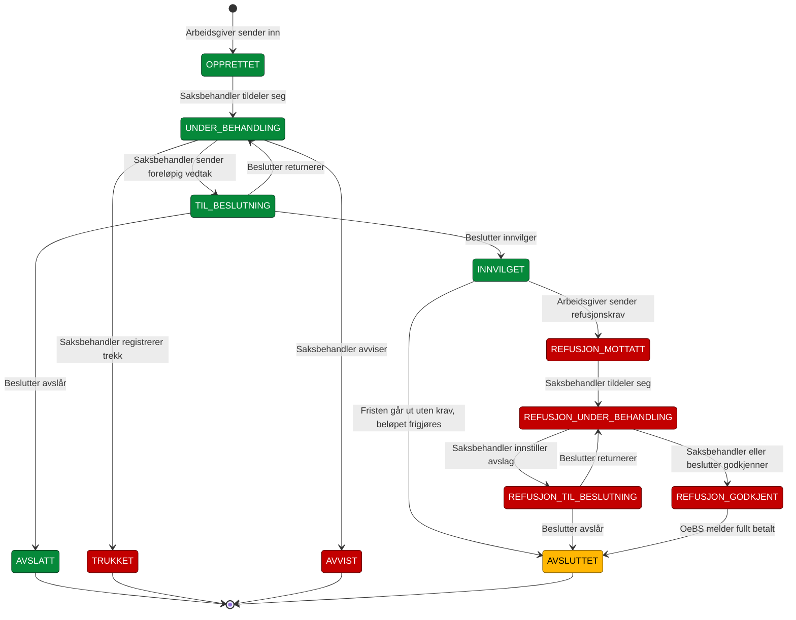

# Aktører og tilstander: fra søknad til utbetalt refusjon

Dette dokumentet viser hva arbeidsgiver, deltaker, saksbehandler og beslutter
gjør med løsningen, fra søknaden sendes inn til refusjonen er utbetalt. Hvert
steg er merket med status, så vi ser hva vi har og hva som mangler.

Gjelder saker i ny saksbehandling (kilde `EKSPERTBISTAND`). Arena-saker
behandles ferdig i Arena og er ikke med. Klage og tilbakekreving er utenfor
løsningen.

Arbeidsgiver ser nye saker på nye sider under en egen rute bak feature toggle
(🛤️). Dagens sider beholdes uendret for Arena-saker.

Andre dokumenter i mappa:

- [Lanseringsplan](lanseringsplan_2027-04-01.md): status, rekkefølge, spor og
  endringslogg fram til 1. april 2027
- [Tidslinje](https://htmlpreview.github.io/?https://github.com/navikt/ekspertbistand/blob/lanseringsplan/planning/lanseringsplan_2027-04-01.html):
  Gantt-diagram over sporene uke for uke

## Interaksjoner

Hvert steg er merket med status:

- 🟢 ferdig bygget, i prod eller i dev
- 🟡 delvis: noe gjenstår å bygge eller koble inn i `main`
- 🔴 mangler

Fargen sier ikke om steget er i prod. Det som er i prod i dag, står i
teksten. Resten av ny saksbehandling går i prod samlet ved go-live (🚦, M4).

Emojien etter statusen er steget i [lanseringsplanen](lanseringsplan_2027-04-01.md),
for eksempel 🧾 for refusjonsbehandling. Statusene er fra 20.11.2026.

```mermaid
sequenceDiagram
    autonumber
    actor AG as Arbeidsgiver
    actor DT as Deltaker
    actor SB as Saksbehandler
    actor BE as Beslutter
    participant EB as Ekspertbistand

    rect rgba(0, 103, 197, 0.08)
    Note over AG,EB: 1. Søknad 🟢🟢🟢🟢🟢🟢
    AG->>EB: 🟢 🪪 Oppgir deltaker, sjekkes mot Aa-reg
    EB-->>AG: 🟢 📨 Informerer om at deltaker får kopi
    AG->>EB: 🟢 Sender inn søknaden
    EB->>EB: 🟢 Journalfører søknaden og oppretter sak
    Note over EB: Søknad innsendt · Sak OPPRETTET
    EB-->>AG: 🟢 Varsel om mottatt søknad
    EB-->>DT: 🟢 📨 Kopi av søknaden (dokdist)
    end

    rect rgba(6, 137, 58, 0.08)
    Note over AG,EB: 2. Saksbehandling 🟢🟢🟢🟢🟢🟢🟢🟡🟡🔴🔴🔴🔴
    SB->>EB: 🟢 Tildeler seg saken
    Note over EB: Sak UNDER_BEHANDLING
    EB->>EB: 🟢 ⚖️ Vilkåret om arbeidsforhold oppfylt fra Aa-reg
    SB->>EB: 🟡 ⚖️ Vurderer vilkårene (tre nye vilkår mangler)
    opt Deltaker er uenig i arbeidsforholdet
        DT->>SB: Tar kontakt med Nav (utenfor løsningen)
        SB->>EB: 🟢 Overstyrer vilkåret
    end
    opt Deltaker trekker seg
        DT->>SB: Ber om at søknaden slettes (utenfor løsningen)
        SB->>EB: 🔴 🛡️ Stanser behandlingen og sletter
    end
    opt Arbeidsgiver trekker søknaden, eller søknaden avvises
        AG->>SB: Ber om å trekke søknaden (utenfor løsningen)
        SB->>EB: 🔴 🚫 Registrerer trukket eller avvist søknad med årsak
        Note over EB: Sak TRUKKET eller AVVIST. Saken er ferdig.
        EB-->>AG: 🔴 🚫 Informasjon om trukket eller avvist søknad
        EB-->>DT: 🔴 🚫 Informasjon om trukket eller avvist søknad (dokdist)
    end
    SB->>EB: 🟡 🏦 Velger kostnadssted (hardkodet liste til 727 er klar)
    SB->>EB: 🟢 Sender foreløpig vedtak med brev
    Note over EB: Sak TIL_BESLUTNING
    BE->>EB: 🟢 Tildeler seg saken
    alt Retur
        BE->>EB: 🟢 Returnerer med årsak
        Note over EB: Sak UNDER_BEHANDLING, oppgave SOKNAD_RETUR
    else Vedtak
        BE->>EB: 🟢 Fatter vedtak
        Note over EB: Sak INNVILGET eller AVSLATT
    end
    end

    rect rgba(255, 145, 0, 0.10)
    Note over AG,EB: 3. Etter vedtak 🟢🟢🟢🟢🟢🟢🟢🟢🟢🟢🔴🔴
    EB->>EB: 🟢 🗄️📝 Journalfører vedtaksbrevet på arbeidsgivermappa, sladdet ved kode 6/7
    EB->>EB: 🔴 🗄️ Journalfører vedtaksbrevet på personmappa
    EB-->>DT: 🔴 📬 Vedtaksbrevet (dokdist)
    alt Innvilget
        EB->>EB: 🟢 🏦 Bestiller hos OeBS, setter av penger (kjører i dev)
        EB->>EB: 🟢 🏦 OeBS kvitterer, bestilling AKTIV, saksloggen viser status
        opt OeBS svarer FEILET
            EB->>EB: 🟢 🏦 Alert til teamet, OeBS retter og kvitterer AKTIV på nytt
        end
        EB-->>AG: 🟢 🔔 Varsel om innvilget, lenke til vedtaket
        AG->>EB: 🟢 🛤️ Åpner vedtaket på ny rute
        EB-->>AG: 🟢 🛤️ Viser innvilget beløp og vedtaksbrevet
        Note over AG,EB: Søknad godkjent
    else Avslått
        EB-->>AG: 🟢 🔔 Varsel om avslag
        AG->>EB: 🟢 🛤️ Åpner vedtaket på ny rute
        EB-->>AG: 🟢 🛤️ Viser avslaget og avslagsbrevet
        Note over AG,EB: Søknad avslatt. Saken er ferdig.
    end
    end

    rect rgba(102, 52, 176, 0.08)
    Note over AG,EB: 4. Gjennomføring og refusjonskrav 🟢🟢🟡🟡🔴🔴🔴🔴🔴
    Note over AG: Eksperten gjennomfører bistanden (utenfor løsningen)
    opt Tiltaket avbrytes før planlagt slutt
        AG->>SB: Melder at tiltaket avsluttes tidlig, eller deltaker gjør det (utenfor løsningen)
        SB->>EB: 🔴 🚫 Legger inn ny sluttdato med notat
        EB-->>AG: 🔴 🚫 Vedtak om avbrutt tiltak
        EB-->>DT: 🔴 🚫 Vedtak om avbrutt tiltak (dokdist)
        Note over EB: Sak INNVILGET med ny sluttdato. Bestillingen annulleres ikke.
    end
    AG->>EB: 🟡 📤 Sender sluttrapport (justeres etter Figma)
    AG->>EB: 🟡 📤 Sender refusjonskrav med vedlegg (justeres etter Figma)
    EB->>EB: 🟢 📤 Avviser krav over innvilget beløp
    EB->>EB: 🟢 🧾 Publiserer event og lager oppgave til saksbehandler
    Note over EB: Refusjonskrav MOTTATT · Sak REFUSJON_MOTTATT
    opt Refusjonskravet er ikke sendt inn
        EB-->>AG: 🔴 📣 To påminnelser før refusjonsfristen
        opt Fristen går ut uten krav
            EB->>EB: 🔴 💸 Avslutter saken og frigjør beløpet (annullerer bestillingen)
        end
    end
    end

    rect rgba(195, 0, 0, 0.07)
    Note over AG,EB: 5. Refusjonsbehandling og utbetaling 🟢🟢🔴🔴🔴🔴🔴🔴🔴🔴🔴
    SB->>EB: 🟢 🧾 Tildeler seg refusjonsoppgaven
    SB->>EB: 🟢 📤 Ser refusjonskravet og sluttrapporten
    Note over SB,BE: To trinn: saksbehandler innstiller, beslutter med BDM avgjør.
    alt Godkjent
        SB->>EB: 🔴 🧾 Innstiller godkjenning, helt eller med redusert beløp (krever sluttrapport)
        BE->>EB: 🔴 🧾 Godkjenner
        Note over EB: Sak REFUSJON_GODKJENT
        EB-->>AG: 🔴 📣 Varsel om godkjent refusjon
        EB->>EB: 🔴 💸 Sender faktura til OeBS
        EB->>EB: 🔴 💸 OeBS melder FULLT_BETALT
        EB->>EB: 🔴 💸 Avslutter saken
        Note over EB: Sak AVSLUTTET · bestilling OPPGJORT
    else Avslag
        SB->>EB: 🔴 🧾 Innstiller avslag
        BE->>EB: 🔴 🧾 Avslår eller returnerer
        EB-->>AG: 🔴 📣 Varsel om avslag (brev avklares)
        Note over EB: Sak AVSLUTTET
    end
    end
```

🟢🟢🟢🟢🟢🟢🟢🟢🟢🟢🟢🟢🟢🟢🟢🟢🟢🟢🟢🟢🟢🟢🟢🟢🟢🟢🟢🟡🟡🟡🟡🔴🔴🔴🔴🔴🔴🔴🔴🔴🔴🔴🔴🔴🔴🔴🔴🔴🔴🔴🔴

🟢 27 ferdig · 🟡 4 delvis · 🔴 20 mangler, av 51 steg i diagrammet. OeBS er ikke egen deltaker i
diagrammet. Kall til og svar fra OeBS vises som steg i Ekspertbistand.

Deltaker får ikke varsel om refusjonen. Bare arbeidsgiver varsles når
refusjonskravet er godkjent eller avslått (18.11.).

### Lenker per steg

Nummeret er nummeret på steget i diagrammet over. GitHub viser ikke lenker
inne i Mermaid-diagrammer, så lenkene til Trello og PR-ene står her.

| # | Steg | Trello \| PR |
|--:|------|--------------|
| 1 | 🟢 🪪 Oppgir deltaker, sjekkes mot Aa-reg | Trello [601](https://trello.com/c/3Oq7KiFc) \| PR [#230](https://github.com/navikt/ekspertbistand/pull/230) |
| 2 | 🟢 📨 Informerer om at deltaker får kopi | Trello [675](https://trello.com/c/2QCwaAJX), [695](https://trello.com/c/lPVEHuKB) |
| 3 | 🟢 Sender inn søknaden | i prod |
| 4 | 🟢 Journalfører søknaden og oppretter sak | Journalføringen er i prod. Saken opprettes i prod ved go-live 🚦 (mangler kort). |
| 5 | 🟢 Varsel om mottatt søknad | Trello [475](https://trello.com/c/GC5c2wJi) |
| 6 | 🟢 📨 Kopi av søknaden (dokdist) | Trello [676](https://trello.com/c/khxsoU0N), [692](https://trello.com/c/LU0D56cu) \| PR [#251](https://github.com/navikt/ekspertbistand/pull/251) |
| 7 | 🟢 Tildeler seg saken | Trello [457](https://trello.com/c/wu5GnoXw) |
| 8 | 🟢 ⚖️ Vilkåret om arbeidsforhold oppfylt fra Aa-reg | Trello [655](https://trello.com/c/WCMkpira) \| PR [#267](https://github.com/navikt/ekspertbistand/pull/267) |
| 9 | 🟡 ⚖️ Vurderer vilkårene (tre nye vilkår mangler) | Trello [474](https://trello.com/c/AR3hzcce), [656](https://trello.com/c/hLd2jDAj) |
| 10 | Tar kontakt med Nav (utenfor løsningen) | utenfor løsningen |
| 11 | 🟢 Overstyrer vilkåret | Trello [655](https://trello.com/c/WCMkpira) |
| 12 | Ber om at søknaden slettes (utenfor løsningen) | utenfor løsningen |
| 13 | 🔴 🛡️ Stanser behandlingen og sletter | Trello [584](https://trello.com/c/ft1q5B6v), [607](https://trello.com/c/aegaxk5R) |
| 14 | Ber om å trekke søknaden (utenfor løsningen) | utenfor løsningen |
| 15 | 🔴 🚫 Registrerer trukket eller avvist søknad med årsak | mangler kort, se [avsnitt 8](lanseringsplan_2027-04-01.md#8-trekke-avvise-avbryte-og-omgjøre) i planen |
| 16 | 🔴 🚫 Informasjon om trukket eller avvist søknad | mangler kort, se [avsnitt 8](lanseringsplan_2027-04-01.md#8-trekke-avvise-avbryte-og-omgjøre) i planen |
| 17 | 🔴 🚫 Informasjon om trukket eller avvist søknad (dokdist) | mangler kort, se [avsnitt 8](lanseringsplan_2027-04-01.md#8-trekke-avvise-avbryte-og-omgjøre) i planen |
| 18 | 🟡 🏦 Velger kostnadssted (hardkodet liste til 727 er klar) | Trello [728](https://trello.com/c/gVCEUEry), [727](https://trello.com/c/6K5Czv2I) |
| 19 | 🟢 Sender foreløpig vedtak med brev | Trello [473](https://trello.com/c/M6Ei4UAR), [468](https://trello.com/c/gh8l45zx) |
| 20 | 🟢 Tildeler seg saken | Trello [476](https://trello.com/c/4kkrg41a) \| PR [#200](https://github.com/navikt/ekspertbistand/pull/200) |
| 21 | 🟢 Returnerer med årsak | Trello [476](https://trello.com/c/4kkrg41a) \| PR [#200](https://github.com/navikt/ekspertbistand/pull/200) |
| 22 | 🟢 Fatter vedtak | Trello [476](https://trello.com/c/4kkrg41a) \| PR [#200](https://github.com/navikt/ekspertbistand/pull/200) |
| 23 | 🟢 🗄️📝 Journalfører vedtaksbrevet på arbeidsgivermappa, sladdet ved kode 6/7 | Trello [691](https://trello.com/c/is5SjNKk) \| PR [#237](https://github.com/navikt/ekspertbistand/pull/237) |
| 24 | 🔴 🗄️ Journalfører vedtaksbrevet på personmappa | Trello [646](https://trello.com/c/4qcIiWBB) |
| 25 | 🔴 📬 Vedtaksbrevet (dokdist) | Trello [599](https://trello.com/c/QA5bXVrf) |
| 26 | 🟢 🏦 Bestiller hos OeBS, setter av penger (kjører i dev) | Trello [650](https://trello.com/c/abzeX7gO), [704](https://trello.com/c/zUU0nQvu) \| PR [#224](https://github.com/navikt/ekspertbistand/pull/224), [#259](https://github.com/navikt/ekspertbistand/pull/259) |
| 27 | 🟢 🏦 OeBS kvitterer, bestilling AKTIV, saksloggen viser status | Trello [705](https://trello.com/c/HShDcuFH), [726](https://trello.com/c/u2XIE5PJ) \| PR [#259](https://github.com/navikt/ekspertbistand/pull/259) |
| 28 | 🟢 🏦 Alert til teamet, OeBS retter og kvitterer AKTIV på nytt | Trello [726](https://trello.com/c/u2XIE5PJ) \| PR [#259](https://github.com/navikt/ekspertbistand/pull/259). Flagging av saken: [724](https://trello.com/c/jgHBBvu3), etter lansering |
| 29 | 🟢 🔔 Varsel om innvilget, lenke til vedtaket | Trello [645](https://trello.com/c/XZvrwKjG) \| PR [#252](https://github.com/navikt/ekspertbistand/pull/252) |
| 30 | 🟢 🛤️ Åpner vedtaket på ny rute | Trello [693](https://trello.com/c/mmcwqp5V) \| PR [#250](https://github.com/navikt/ekspertbistand/pull/250) |
| 31 | 🟢 🛤️ Viser innvilget beløp og vedtaksbrevet | Trello [693](https://trello.com/c/mmcwqp5V), [681](https://trello.com/c/H7jYzwos) \| PR [#250](https://github.com/navikt/ekspertbistand/pull/250) |
| 32 | 🟢 🔔 Varsel om avslag | Trello [645](https://trello.com/c/XZvrwKjG) \| PR [#252](https://github.com/navikt/ekspertbistand/pull/252) |
| 33 | 🟢 🛤️ Åpner vedtaket på ny rute | Trello [693](https://trello.com/c/mmcwqp5V) \| PR [#250](https://github.com/navikt/ekspertbistand/pull/250) |
| 34 | 🟢 🛤️ Viser avslaget og avslagsbrevet | Trello [693](https://trello.com/c/mmcwqp5V) \| PR [#250](https://github.com/navikt/ekspertbistand/pull/250) |
| 35 | Melder at tiltaket avsluttes tidlig, eller deltaker gjør det (utenfor løsningen) | utenfor løsningen |
| 36 | 🔴 🚫 Legger inn ny sluttdato med notat | mangler kort, se [avsnitt 8](lanseringsplan_2027-04-01.md#8-trekke-avvise-avbryte-og-omgjøre) i planen |
| 37 | 🔴 🚫 Vedtak om avbrutt tiltak | mangler kort, se [avsnitt 8](lanseringsplan_2027-04-01.md#8-trekke-avvise-avbryte-og-omgjøre) i planen |
| 38 | 🔴 🚫 Vedtak om avbrutt tiltak (dokdist) | mangler kort, se [avsnitt 8](lanseringsplan_2027-04-01.md#8-trekke-avvise-avbryte-og-omgjøre) i planen |
| 39 | 🟡 📤 Sender sluttrapport (justeres etter Figma) | Trello [686](https://trello.com/c/W4cdyLLf), [683](https://trello.com/c/omYxyPPP) \| PR [#247](https://github.com/navikt/ekspertbistand/pull/247), [#268](https://github.com/navikt/ekspertbistand/pull/268) |
| 40 | 🟡 📤 Sender refusjonskrav med vedlegg (justeres etter Figma) | Trello [685](https://trello.com/c/ZY79MovZ), [684](https://trello.com/c/hxzNc8Z4) \| PR [#247](https://github.com/navikt/ekspertbistand/pull/247), [#270](https://github.com/navikt/ekspertbistand/pull/270) |
| 41 | 🟢 📤 Avviser krav over innvilget beløp | Trello [620](https://trello.com/c/NoJhv4wi) \| PR [#247](https://github.com/navikt/ekspertbistand/pull/247) |
| 42 | 🟢 🧾 Publiserer event og lager oppgave til saksbehandler | Trello [702](https://trello.com/c/TK7W0dt3) \| PR [#248](https://github.com/navikt/ekspertbistand/pull/248), [#249](https://github.com/navikt/ekspertbistand/pull/249) |
| 43 | 🔴 📣 To påminnelser før refusjonsfristen | mangler kort, se [Avklart](lanseringsplan_2027-04-01.md#avklart) i planen |
| 44 | 🔴 💸 Avslutter saken og frigjør beløpet (annullerer bestillingen) | mangler kort, se [Avklart](lanseringsplan_2027-04-01.md#avklart) i planen |
| 45 | 🟢 🧾 Tildeler seg refusjonsoppgaven | PR [#248](https://github.com/navikt/ekspertbistand/pull/248) |
| 46 | 🟢 📤 Ser refusjonskravet og sluttrapporten | Trello [477](https://trello.com/c/YJI9Yf9G) |
| 47 | 🔴 🧾 Innstiller godkjenning, helt eller med redusert beløp (krever sluttrapport) | Trello [715](https://trello.com/c/KBHePFbQ), [716](https://trello.com/c/BvM7Dir9) (kort for behandlingen mangler) |
| 48 | 🔴 🧾 Godkjenner | Trello [716](https://trello.com/c/BvM7Dir9) (kort for behandlingen mangler) |
| 49 | 🔴 📣 Varsel om godkjent refusjon | mangler kort |
| 50 | 🔴 💸 Sender faktura til OeBS | Trello [679](https://trello.com/c/Cue4nB5k) |
| 51 | 🔴 💸 OeBS melder FULLT_BETALT | Trello [679](https://trello.com/c/Cue4nB5k) |
| 52 | 🔴 💸 Avslutter saken | mangler kort |
| 53 | 🔴 🧾 Innstiller avslag | Trello [716](https://trello.com/c/BvM7Dir9) (kort for behandlingen mangler) |
| 54 | 🔴 🧾 Avslår eller returnerer | Trello [716](https://trello.com/c/BvM7Dir9) (kort for behandlingen mangler) |
| 55 | 🔴 📣 Varsel om avslag (brev avklares) | mangler kort, se funn 5 |

## Tilstander for saken

Grønn finnes i `Saksstatus`. Gul finnes i enumen, men ingenting setter den.
Rød er forslag, og navnene avklares i specen for 🧾.

Avbrudd av tiltaket endrer sluttdatoen, ikke statusen. Saken står som
`INNVILGET`, fordi arbeidsgiver fortsatt skal kunne sende refusjonskrav.
Omgjøring av vedtak er ikke med i diagrammene, fordi det ikke er avklart om
den skal med i første release. Se [avsnitt 8](lanseringsplan_2027-04-01.md#8-trekke-avvise-avbryte-og-omgjøre) i planen.

## Tilstander på tvers

Hver aktør ser sin egen status. Tabellen viser hvordan de henger sammen.

| Fase | Søknad (arbeidsgiver ser) | Sak (saksbehandling) | Refusjonskrav (arbeidsgiver ser) | OeBS |
|------|---------------------------|----------------------|----------------------------------|------|
| Utkast | 🟢 `utkast` | – | – | – |
| Sendt inn | 🟢 `innsendt` | 🟢 `OPPRETTET` | – | – |
| Under behandling | 🟢 `innsendt` | 🟢 `UNDER_BEHANDLING` | – | – |
| Til beslutning | 🟢 `innsendt` | 🟢 `TIL_BESLUTNING` | – | – |
| Avslått | 🟢 `avslatt` | 🟢 `AVSLATT` | – | – |
| Trukket | 🔴 `trukket` | 🔴 `TRUKKET` | – | – |
| Avvist | 🔴 `avvist` | 🔴 `AVVIST` | – | – |
| Innvilget | 🟢 `godkjent` | 🟢 `INNVILGET` | – | 🟢 bestilling `SENDT`, så `AKTIV` |
| Tiltak avbrutt | 🟢 `godkjent` | 🟢 `INNVILGET`, 🔴 ny sluttdato | – | 🟢 `AKTIV`, annulleres ikke |
| Krav sendt | 🟢 `godkjent` | 🔴 `REFUSJON_MOTTATT` | 🟡 `MOTTATT` | 🟢 `AKTIV` |
| Krav under behandling | 🟢 `godkjent` | 🔴 `REFUSJON_UNDER_BEHANDLING` | 🔴 under behandling | 🟢 `AKTIV` |
| Krav godkjent | 🟢 `godkjent` | 🔴 `REFUSJON_GODKJENT` | 🔴 godkjent | 🔴 faktura `SENDT` |
| Utbetalt | 🟢 `godkjent` | 🟡 `AVSLUTTET` | 🔴 utbetalt | 🔴 faktura `FULLT_BETALT`, bestilling `OPPGJORT` |
| Krav avslått | 🟢 `godkjent` | 🟡 `AVSLUTTET` | 🔴 avslått | 🔴 bestilling `ANNULLERT`? |
| Frist utløpt uten krav | 🟢 `godkjent` | 🟡 `AVSLUTTET` | – | 🔴 bestilling `ANNULLERT`, beløpet frigjort |

## Funn

Kartleggingen viser disse hullene i tillegg til det som står i
lanseringsplanen:

1. **Hendelsene for refusjonskrav og sluttrapport er ikke komplette.** Vi
   publiserer hendelser når kravet og rapporten er mottatt ([#249](https://github.com/navikt/ekspertbistand/pull/249)), og
   oppgavelista utleder oppgavene fra tabellene ([#248](https://github.com/navikt/ekspertbistand/pull/248)). Hendelser for
   bekreftet sluttrapport ([715](https://trello.com/c/KBHePFbQ)) og for krav
   sendt til utbetaling eller avslått ([716](https://trello.com/c/BvM7Dir9))
   mangler. Det hører til 🧾.
2. **Saken har ingen tilstander etter `INNVILGET`.** `Oppgavetype` har fått
   `REFUSJON` og `SLUTTRAPPORT` ([#248](https://github.com/navikt/ekspertbistand/pull/248)), men oppgavene avsluttes ikke ennå.
   `AVSLUTTET` finnes, men ingenting setter den. Vi må velge om
   refusjonsstatusene skal ligge i `Saksstatus` eller på refusjonskravet.
3. **Arbeidsgiver ser bare `MOTTATT` på refusjonskravet.** Visningen av
   refusjonskravet på ny rute må vise godkjent, avslått og utbetalt.
4. **Fristen går ut uten refusjonskrav.** Avklart 18.11.: arbeidsgiver får
   to påminnelser før fristen. Kommer ikke kravet, frigjøres beløpet ved at
   bestillingen annulleres, og saken avsluttes. Vi må avklare om det skjer
   automatisk, og når påminnelsene sendes.
5. **Avslag på refusjonskravet.** Avklart 18.11. og 20.11.: både godkjenning og avslag krever to trinn,
   og bare arbeidsgiver varsles. Et avslag er også et vedtak, så vi må
   avklare om arbeidsgiver får brev, om bestillingen skal annulleres og
   hvordan vi forhåndsvarsler. Første kontroll, der arbeidsgiver bes sende
   vedlegg på nytt, regnes ikke som forhåndsvarsel.
6. **`AVSLUTTET` dekker tre utfall:** utbetalt, avslått krav og utløpt frist.
   Trenger fag eller statistikken å skille dem?
7. **OeBS-integrasjonen kjører i dev, men ikke i prod.** Runde 1 mot T1 ble
   godkjent 13.11. ([704](https://trello.com/c/zUU0nQvu), [705](https://trello.com/c/HShDcuFH),
   [706](https://trello.com/c/qnJXAfzO)). [#259](https://github.com/navikt/ekspertbistand/pull/259) ble merget 20.11.: prosesseringen
   kjører i dev, og saksloggen viser status fra OeBS (726). Prod er ikke skrudd
   på, og lesetilgangen i prod venter på Valp ([#8573](https://github.com/navikt/mulighetsrommet/pull/8573)). Ingen flyt annullerer
   ennå. Faktura og oppgjør (runde 2) venter på OeBS. Kostnadssted er ikke
   behandlende enhet, så saksbehandler må velge det (728).
8. **En feilet bestilling retter seg via OeBS.** `FEILET` gir alert i Slack
   og vises med feilkode i saksloggen. Teamet melder feilen til OeBS, og OeBS
   sender ny kvittering med `AKTIV` når feilen er rettet. Koden tar alltid
   siste status. Tiltaksøkonomi sender ikke faktura før bestillingen er
   aktiv. Å flagge saken hos oss (724) venter til etter lansering.
